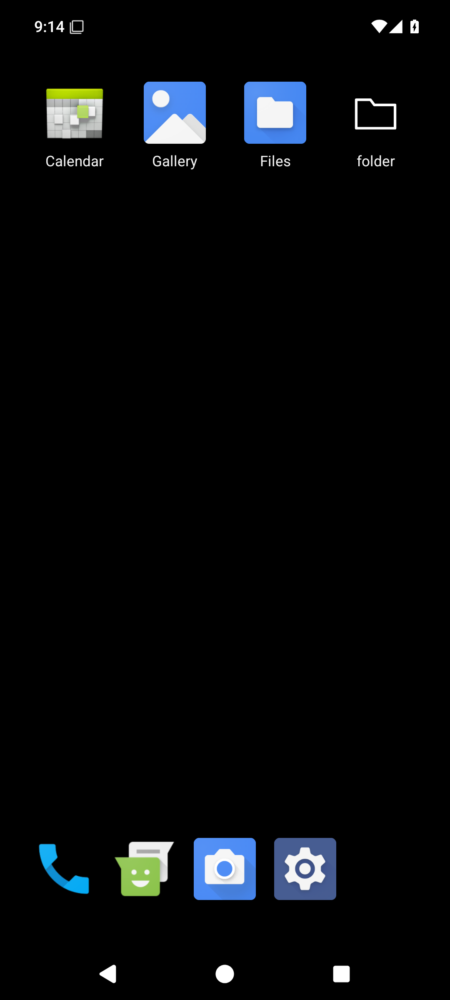
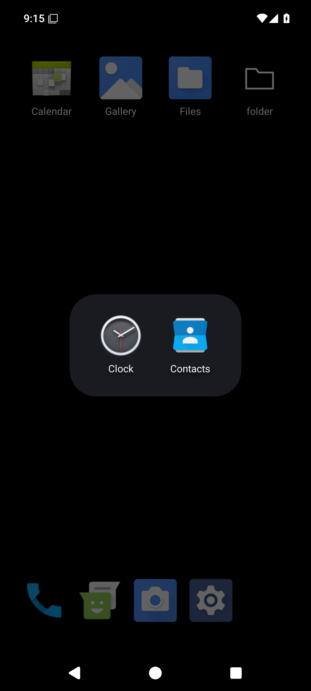
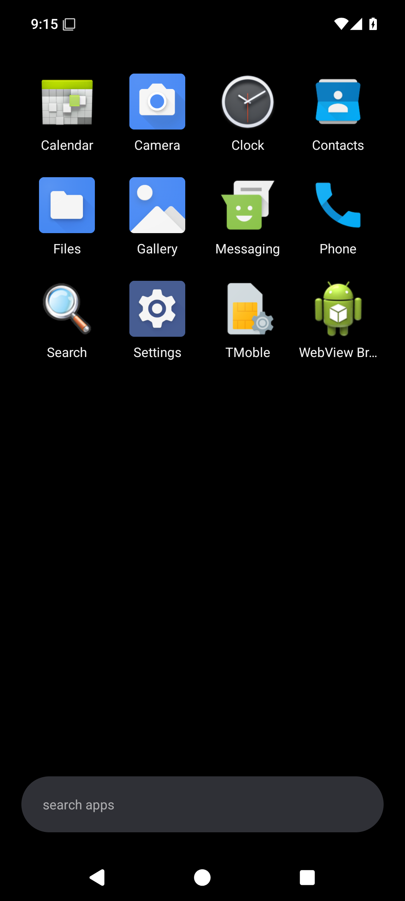
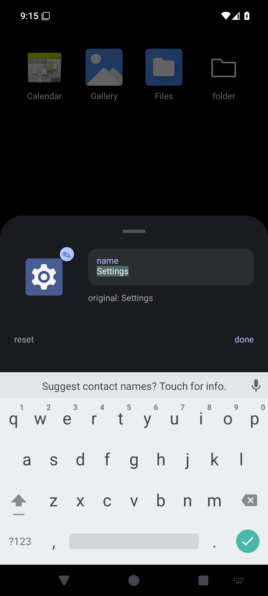
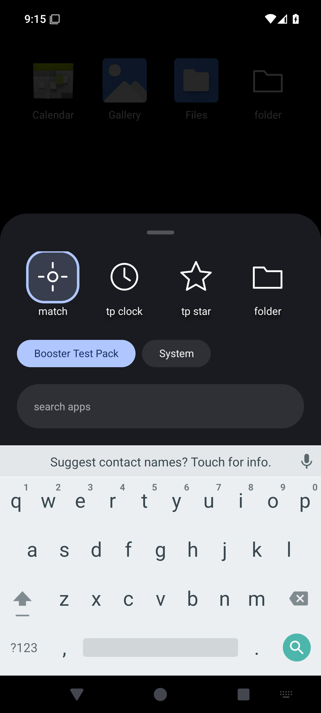
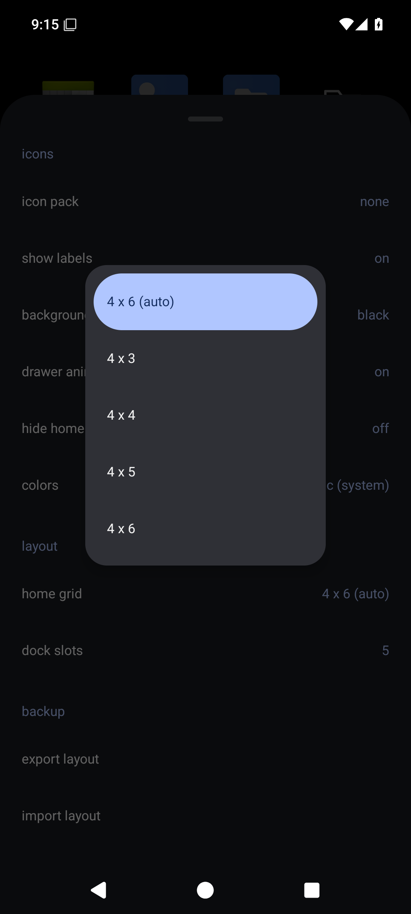

#  booster

lightweight android launcher where every icon and name is customizable.

  
  

## features

- paged home grid (4 columns; as many rows as fit, or a fixed 3 to 12) and a
  dock (3 to 6 slots).
- an app drawer as one plain grid, with the search bar at the bottom. it
  sorts by name until you rearrange it by dragging. apps can be hidden from
  the grid and stay findable by search.
- "add to home" from browsers and other apps. shortcuts behave like apps on
  home, in the dock and in folders.
- folders on the home grid, in the dock, and in the drawer. an open folder
  is a centered card holding a near-square grid.
- custom icons for apps and folders from any installed icon pack
  (adw / nova / go format, including arcticons) or from any other app
  ("System").
- custom names for apps and folders.
- one global icon pack, with per-item overrides on top. custom icons follow
  the pack by name, or fall back to the matching app's own icon.
- one way of dragging everywhere: onto an item to swap them, onto a folder to
  add an app, between two items to insert, or onto the remove / edit / app
  info targets above the dock. new folders come from "add to folder" in the
  long-press menu.
- android 12+ dynamic colors for accents and sheets; black background, with
  the system wallpaper as an option.
- export and import the whole layout as json, or start from the default
  layout with "import defaults" in settings.

## using it

| gesture | where | does |
|---|---|---|
| tap | app / folder | launch / open |
| long press | app / folder | menu; keep moving to drag instead |
| long press | empty home space | background, settings, add / remove page |
| swipe up | anywhere on home | open the drawer; it follows your finger |
| swipe down | drawer at top, any sheet | close it; it follows your finger |
| drag within | home, dock, drawer, an open folder | rearrange apps and folders |
| drag to search bar | the drawer | close the drawer to drop on home or the dock |
| swipe sideways | home | change page |
| back or home | anywhere | close the top sheet, menu, folder or drawer |

going home from an app returns you to the first home page, with the drawer and
any folder closed. with "remember drawer" on, it returns you to the page, drawer
and folder as you left them; press home again to close them.
the page line above the dock appears only while you switch pages.

to set an icon: long press an app or folder, choose "edit icon & name", then
tap the icon. pick from an installed pack, or from "System" for another
app's icon. "reset" restores the default.

to use an icon pack everywhere: long press empty home space, "launcher
settings", "icon pack", and pick from the popup. the same settings turn the
drawer animation off and can hide apps that are already on home or the dock
from the drawer ("hide home apps from drawer").

dragging an app out of a drawer folder puts a shortcut on home or the dock and
leaves the folder as it was. "drawer order" in settings returns the drawer to
sorting by name. folder names are unique on home and in the drawer, each on
its own, so the two can share a name.

"folder stacks" in settings changes how the drawer shows folders. each folder
becomes one slot, and each swipe up slides a new page over the last, with every
slot on its next app; a folder that runs out leaves its slot empty. swipe down
to step back, and from the first page to close the drawer. to rearrange the
drawer or edit its folders, turn it off first.

"add to home" in another app works while booster is the default home app.

booster also has an ordinary app icon, so you can try it from your current
home screen before making it the default home app.

## installing

signed apks are attached to each [github release](../../releases), with a
sha256 alongside.

## building

requires [mise](https://mise.jdx.dev) for the pinned toolchain
(java, android sdk, python, ruff).

```
mise install
make            # debug apks: app and the test icon pack
make release    # minified release apk (VERSION=1.2.3 to set the version)
make screenshots # refresh docs/screenshots from the emulator
make test-e2e   # end-to-end suite on the project's own emulator
make precommit  # build, android lint, ruff
```

install with `adb install app/build/outputs/apk/debug/app-debug.apk`, then
choose booster as the home app.
